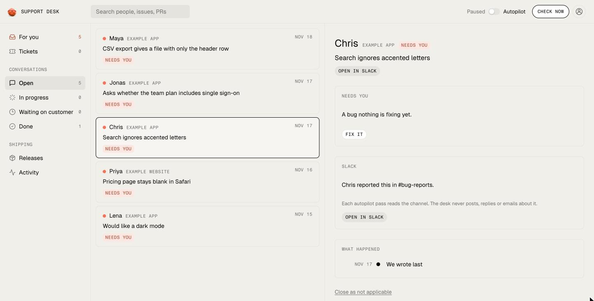
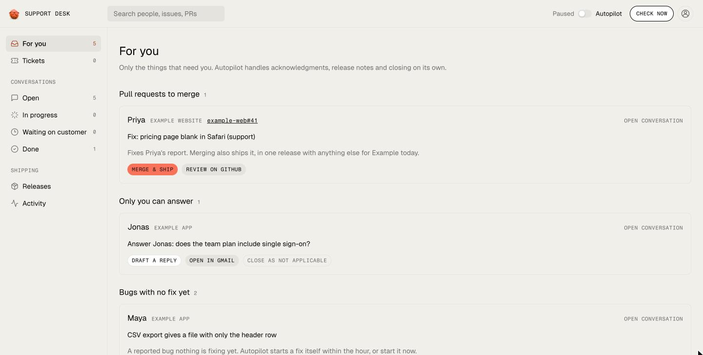

# Support Desk Kit

An inbox-to-desk agent built with [Claude Code](https://claude.com/claude-code).
It reads a mailbox every hour and turns each thread into a conversation on a
local web desk. It acknowledges and triages new mail in your voice, starts fix
sessions that open GitHub pull requests, tells people when their fix is live,
and closes what's done. You approve merges and anything sensitive from the
desk.

It's set up for customer support, but the same loop works for sales or any
inbox (see [Use it for sales or any inbox](#use-it-for-sales-or-any-inbox)).
Everything runs on your own machine.

<picture>
  <source media="(prefers-color-scheme: dark)" srcset="docs/desk-dark.jpg">
  
</picture>

<details>
<summary>More: the For you view</summary>



</details>

*Screenshots use the fictional sample data in `dashboard/sample/`.*

## How it works

```
 mailbox (Gmail via Composio)   Slack channel (optional, read-only)
              │                          │
              ▼                          ▼
   hourly pass: a background Claude Code session following dashboard/pass-runbook.md
     reads the inbox ─▶ dashboard/conversations.json ─▶ dashboard/refresh.py ─▶ dashboard/out/*.json
     acknowledges, labels, sends due notes, closes                                     │
              │                                                                       ▼
              └──── needs_fix ──▶ fix session ─▶ GitHub PR            the desk: http://127.0.0.1:4150
                                                                     (buttons start more sessions)
```

- **The desk** (`desk/server.py`) is a small Python web app with no
  dependencies. It listens on `127.0.0.1:4150`, behind one owner password.
  It has these views:
  - **For you:** replies to approve, merges, questions only you can answer
  - **Conversations:** open, in progress, waiting on the customer, done
  - **Releases**, **Activity** (sessions at work and the pass log) and
    **Tickets**
  - a configurable animated 3D mascot

  It reads the data files from disk every few seconds.
- **The hourly pass.** While the desk runs, its autopilot starts a background
  Claude Code session (`claude --bg`, auto permission mode) about once an hour
  within `autopilot.pass_hours`. The session follows `dashboard/pass-runbook.md`:
  - read the inbox, and update the rows
  - acknowledge new bugs, answer feature ideas, and leave sensitive mail for
    you
  - send the release notes that are due
  - close what's done
  - log the pass

  The autopilot also starts up to `autopilot.fix_cap` fix sessions a day for
  rows marked `needs_fix`, and once a day a tripwire (checks what was sent) and
  a digest (a 7-day summary in your inbox).
- **Runbooks.** Every session is told to follow one Markdown runbook in
  `dashboard/`, and every runbook defers to `dashboard/rules.md`. The runbooks
  are the agent's behavior: read them, and change them to change what it does.
  `dashboard/README.md` lists them all.
- **Sessions.** Every button that acts starts a background session:
  - **Check now**, **Draft a reply**, **Send** and **Close as not applicable**
    start in the kit root.
  - **Fix it**, **Build it**, **Merge & ship**, and **Start the release** or
    **Submit for review**, start in the product's own checkout.
  - **Work on it** starts in the ticket's project folder.

  The desk shows each one's live state. **Open in Claude** hands it to the
  Claude app, where you can follow it or answer it.
- **Tickets.** Things only you can do (a merge, a decision, a sign-in) sit
  in the Tickets view, apart from the conversations. A session adds one only
  when you ask (`python3 desk/tickets.py add …`). **Work on it** starts a
  session by `desk/ticket-runbook.md`, at most 4 at once (`desk.ticket_cap`).
- **Data files.** Rows live in `dashboard/conversations.json`, curated by
  sessions. `refresh.py` adds GitHub state and writes `dashboard/out/*.json`
  for the desk. Small scripts (`work.py`, `drafts.py`, `notify.py`,
  `passlog.py`, `ship.py`, `desk/tickets.py`) are the only other writers. All
  of them are gitignored and stay on your machine.

## Requirements

- **macOS.** The desk keeps its password and caches under `~/Library`, and the
  login item is a LaunchAgent.
- **Python 3.10 or later, built with OpenSSL** (Homebrew's `python3` or python.org's). The standard library is
  all it needs, but the owner password uses `hashlib.scrypt`, which the Python bundled with Xcode lacks. The desk
  stops at startup with a clear message if yours doesn't have it.
- **The Claude Code CLI**, signed in (`claude auth login`), recent enough to
  run background sessions (`claude --bg`). Sessions run in auto permission
  mode.
- **claude.ai connectors** on the same Claude account:
  - **Composio**, with your Gmail account connected inside Composio.
    Sessions reach Gmail only through it.
  - **Slack**, optional, for a read-only bug-report channel.
- **The GitHub CLI** (`gh`), signed in (`gh auth login`) as an account that
  can read your product repos, open PRs and merge them.
- Your product repos cloned under one folder (`desk.code_dir`, `~/code` by
  default).

## Setup

1. **Clone the kit** next to your product repos:

   ```bash
   cd ~/code
   git clone https://github.com/your-github-user/support-desk-kit.git
   cd support-desk-kit
   ```

2. **Make your config:**

   ```bash
   cp config.example.json config.json
   ```

   `config.json` is gitignored. It names your accounts, but it never holds a
   password or an API key.

3. **Fill it in.** `python3 config.py` prints what the desk will use.

   | Key | What to put there |
   | --- | --- |
   | `desk.owner_name` | Your first name. Emails are written as you |
   | `desk.desk_name`, `desk.use_case` | The desk's title, and `support` (or `sales`, …) |
   | `desk.port`, `desk.public_origin` | `4150`, and an HTTPS origin only if you set up public access (step 7) |
   | `desk.code_dir` | The folder your product repos are cloned in |
   | `support.mailbox` | The address people write to, such as `support@example.com` |
   | `support.gmail_authuser` | The Google account that mailbox lands in. The desk's Gmail links use it, and the digest goes there |
   | `support.composio_gmail_account`, `support.composio_workbench_tool` | From [Connecting your inbox](#connecting-your-inbox) |
   | `support.our_domains` | Your own domains. Mail from them is "us", and nothing is ever sent to them |
   | `support.reply_signature` | The name emails are signed with |
   | `support.from_name` | The display name on outgoing mail, such as `Support` |
   | `support.label_prefix` | The parent Gmail label, such as `support` |
   | `support.skip_domains` | Optional: sender domains that are never support (vendors, pitches) |
   | `support.relay_senders`, `support.test_senders`, `support.crash_subjects` | Optional: the sender names your in-app contact form sends as, the addresses you test from, and the subjects of automated crash reports |
   | `slack.*` | See `dashboard/slack.md`. Leave `enabled` false to skip Slack |
   | `github.owner` | The GitHub user or org that owns your product repos |
   | `products` | One entry per product: its GitHub `repo`, its `folder` under `code_dir`, and an optional `platform` label. Fix sessions route by this map |
   | `ticket_products` | Product name → folder under `code_dir`, where ticket sessions start |
   | `autopilot` | `pass_hours` (start and end hour, local time), `fix_cap` (automatic fix sessions a day), and `tripwire_at` and `digest_at` (`HH:MM`) |

4. **Trust the folders.** Open Claude Code once in the kit folder and in each
   product folder, and accept the workspace trust prompt, so background
   sessions can start there.

5. **Start the desk, with the autopilot paused** until you've connected your
   inbox and checked a first refresh:

   ```bash
   printf '{"on": false}\n' > desk/autopilot.json
   python3 desk/server.py
   ```

   Open http://127.0.0.1:4150 and **choose the owner password**. Password setup
   works only over a direct local connection to this machine. From anywhere
   else, the desk offers sign-in only, and there's no sign-up. The Autopilot
   switch in the header turns it on later.

6. **Optional: start it at login.** Run this from the kit root. It writes a
   LaunchAgent that starts the desk at login and restarts it if it stops:

   ```bash
   KIT="$PWD"
   PY="$(command -v python3)"
   TOOLS="$(dirname "$(command -v claude)"):$(dirname "$(command -v gh)"):/usr/bin:/bin"
   cat > ~/Library/LaunchAgents/com.example.support-desk.plist <<EOF
   <?xml version="1.0" encoding="UTF-8"?>
   <!DOCTYPE plist PUBLIC "-//Apple//DTD PLIST 1.0//EN" "http://www.apple.com/DTDs/PropertyList-1.0.dtd">
   <plist version="1.0">
   <dict>
     <key>Label</key><string>com.example.support-desk</string>
     <key>ProgramArguments</key>
     <array><string>$PY</string><string>$KIT/desk/server.py</string></array>
     <key>WorkingDirectory</key><string>$KIT</string>
     <key>EnvironmentVariables</key>
     <dict><key>PATH</key><string>$TOOLS</string></dict>
     <key>RunAtLoad</key><true/>
     <key>KeepAlive</key><true/>
     <key>StandardOutPath</key><string>$HOME/Library/Logs/support-desk.log</string>
     <key>StandardErrorPath</key><string>$HOME/Library/Logs/support-desk.log</string>
   </dict>
   </plist>
   EOF
   launchctl bootstrap gui/$(id -u) ~/Library/LaunchAgents/com.example.support-desk.plist
   ```

   To stop it, run `launchctl bootout gui/$(id -u)/com.example.support-desk`.

7. **Optional: reach it from your phone** through a
   [Cloudflare Tunnel](https://developers.cloudflare.com/cloudflare-one/connections/connect-networks/).
   The desk still binds to `127.0.0.1`, and the tunnel forwards one HTTPS
   hostname to it:

   ```yaml
   # ~/.cloudflared/config.yml
   tunnel: <your tunnel id>
   credentials-file: <path to the tunnel's credentials json>
   ingress:
     - hostname: desk.example.com
       service: http://127.0.0.1:4150
     - service: http_status:404
   ```

   Then start the desk with that exact origin:

   ```bash
   SUPPORT_DESK_PUBLIC_ORIGIN=https://desk.example.com python3 desk/server.py
   ```

   You can set `desk.public_origin` in `config.json` instead. The tunnel must
   pass the public `Host` and `Origin` through unchanged, which is
   cloudflared's default. The machine has to stay awake and online. Consider
   putting Cloudflare Access in front of the hostname as a second lock.

**Recovery:** `python3 desk/desk_auth.py set-password` sets a new password from
the terminal, and signs out every device.

## Connecting your inbox

1. **Connect Gmail in Composio.** In claude.ai, add the Composio connector
   (Settings → Connectors). Then, in Composio, connect the Google account the
   mailbox lands in. Claude Code picks up claude.ai connectors when it's
   signed in with the same account. Check with `/mcp` in a `claude` session.
2. **Find the connected account id.** Composio lists your connected accounts
   with their ids. You can also start `claude` in the kit root and ask: "Use
   Composio to list my Gmail connections and show each connected account id.
   Don't read any mail." Put the id in `support.composio_gmail_account`. Every
   session passes it on every Gmail call and refuses any other account.
3. **Find the workbench tool's name.** It's the `COMPOSIO_REMOTE_WORKBENCH`
   tool as Claude Code names it, for example
   `mcp__claude_ai_Composio__COMPOSIO_REMOTE_WORKBENCH`. `/mcp` shows it. Put
   it in `support.composio_workbench_tool`.
4. **Sending as the mailbox.** If `support.mailbox` is an alias or a group
   that delivers into another account, add it in Gmail as a "Send mail as"
   address. Otherwise replies go out from the account's own address.
5. **Create the labels** in Gmail, nested under your prefix:
   - `support/triaged`
   - `support/bug`
   - `support/acknowledged`
   - `support/fix-in-review`
   - `support/needs-owner`
   - `support/resolved`
   - `support/digest`

   A pass also creates any of these that are missing. Labels are the shared
   state between sessions (`dashboard/rules.md`, section 9).
6. **Test a read.** Start `claude` in the kit root and ask: "Do step 1 of
   `dashboard/refresh-runbook.md` and show me the first 20 lines of the
   output. Don't change any file." You should see something like this:

   ```
   read_at 2026-11-18T09:00:12Z | 41 threads, 3 with messages since 2026-11-04T09:00:00Z
   ## 1e00000000000001 NEW | Export gives an empty file |  | 2 msgs | last 2026-11-18T08:41Z customer
     2026-11-18T08:12Z Maya: Exporting to CSV gives me a file with only the header...
   ```

   Names are first names only, and addresses come back as `[email]`.
7. **Build the first rows without sending anything.** With the autopilot still
   paused, start `claude` in the kit root and ask it to "Follow
   `dashboard/refresh-runbook.md`". It reads the inbox and writes rows, and
   sends nothing. Look the rows over in the desk, and use **Close as not
   applicable** on anything that's already handled. If fixes were already live
   before you started, run `python3 dashboard/notify.py baseline` once, so
   nobody gets old news. Then turn the autopilot on.

### How a pass turns threads into rows

`dashboard/gmail_digest.py` runs inside the Composio workbench, never locally.
The session pastes in your `support` settings, the last read time and the
known thread ids. The script lists the mailbox's threads (anything under your
labels from the last 60 days, plus anything sent to the mailbox in the last 30
days), and reads them. It prints a compact digest with first names only and
every address blanked.

The session then edits `dashboard/conversations.json`:
- one row per conversation: first name, product, a one-line issue in its own
  words, status from the labels, last activity, thread ids, linked PRs, what's
  owed, and whether it needs a fix
- no rows for spam, pitches, notifications or your own tests

`dashboard/refresh-runbook.md` has the field rules. Then
`python3 dashboard/refresh.py` adds each PR's state from GitHub and writes the
files the desk reads.

### A different inbox or provider

- **Another Gmail mailbox:** change `support.mailbox`, `gmail_authuser`,
  `composio_gmail_account` and `our_domains`. One kit serves one mailbox. Run a
  second clone, with its own `desk.port`, for a second one.
- **Another provider** (Outlook, Fastmail, a help-desk tool). The contract is
  `dashboard/conversations.json`, so only the Gmail edges change:
  - Replace `gmail_digest.py` with a reader for your provider that prints the
    same kind of digest. Composio has toolkits for many providers.
  - Replace the Gmail calls the runbooks name (fetch a thread, list and modify
    labels, send in a thread) with your provider's own, and keep the rules
    around them.
  - Use your provider's folders or tags for the label vocabulary.
  - Conversation ids must be 16 lowercase hex characters, because the desk
    validates them. Derive one from your provider's thread id, as `slack.md`
    does for Slack messages.
  - The desk's in-app message view (`desk/thread_fetch.py`) reads Gmail only.
    Replace it, or open threads in your provider instead.

## Use it for sales or any inbox

The loop of reading, rows, drafts and follow-ups doesn't care what the mail is
about. Here's a worked example for a sales inbox, where nothing goes out
without your OK.

**What changes:**
- **Rows are leads.** `product` is what they're interested in, and `issue` is
  what they want ("Wants a quote for 40 seats").
- **`needs_fix` is always `false`**, and `prs` is always empty. No fix or
  release sessions start.
- **`owed` holds follow-ups:** "Follow up with Dana on Friday: quote sent, no
  answer".
- **Drafts are replies for you to approve.** A pass never sends. It saves a
  draft, and you press Send.
- **The labels become lead stages:**

  | Label | Row `status` | Meaning |
  | --- | --- | --- |
  | `sales/new` | `triaged` | a new lead, or a lead's new message, still to answer |
  | `sales/replied` | `waiting-on-customer` | we answered, and it's their turn |
  | `sales/meeting` | `triaged` | a call is booked or being booked |
  | `sales/won-lost` | `resolved` | closed either way: `issue` says which |

  Keep `sales/digest` for the digest.

**Exactly what to edit:**

1. **`config.json`:**
   - `desk.desk_name`: `"Sales Desk"`
   - `desk.use_case`: `"sales"`
   - `support.mailbox`: `"sales@example.com"`
   - `support.label_prefix`: `"sales"`
   - `products`: `{}`, so no Fix it or Build it buttons appear
   - `autopilot.fix_cap`: `0`
2. **`dashboard/rules.md`:**
   - Section 5: replace the list with "Nothing is sent automatically. Every
     reply is a draft the owner approves."
   - Section 6: replace the four lines with your own first-reply line ("Thanks
     for getting in touch. …") and follow-up line ("Just checking in on the
     quote I sent. …").
   - Section 9: replace the label table with the sales labels above.
3. **`dashboard/refresh-runbook.md`, field rules:**
   - `product` and `issue` as above
   - `labels` and `status` by the table above
   - `needs_fix`: always `false`, and `prs`: always `[]`
   - `owed`: the next follow-up, and when
   - Which threads get a row: a real person asking to buy, never a vendor
     pitching you.
4. **`dashboard/pass-runbook.md`:**
   - **Step 2:** for each lead that needs a reply (new, the lead wrote after
     our last message, or a follow-up is due), save a draft by step 4 of
     `reply-runbook.md` and set `owed`. Label new leads `sales/new`. Send
     nothing.
   - **Step 3** (release notes): delete it.
   - **Step 4:** close only when the lead says no. Otherwise you close from
     the desk.
5. **`dashboard/send-runbook.md`, step 5:** after sending, swap `sales/new` for
   `sales/replied`, and set `status` to `waiting-on-customer`.
6. **`dashboard/close-runbook.md`:** add `sales/won-lost` instead of
   `<prefix>/resolved`, and remove the other stage labels.
7. **`dashboard/digest-runbook.md`, step 3:** use the stage names (New,
   Replied, Meeting, Won or lost) for the status words.

`fix-runbook.md`, `ship-runbook.md` and `notify-runbook.md` go unused: with no
PRs, nothing is ever due. The tripwire works as it is, and it still flags
anything sent where it shouldn't be.

The same recipe fits other inboxes, such as partnerships, recruiting or a
community inbox: pick the stages, map them onto the five statuses the desk
knows (`triaged`, `waiting-on-customer`, `needs-owner`, `fix-in-review`,
`resolved`), and say in the runbooks what may be sent without you.

## Security model

- **One owner password, and nothing works without it.**
  - There's no default password and no setting that turns sign-in off. Until
    one is set, the desk page sends you to set it up, and every API and action
    answers 401.
  - It's set on the first visit, only over a direct local connection (from
    `127.0.0.1` or `::1`, with no proxy headers). It must be at least 7
    characters; a long passphrase is better if you open the desk to the web.
  - Reached through a tunnel or any proxy before a password exists, the desk
    shows as locked and refuses setup, so nobody else can claim it.
  - From anywhere else, the desk offers sign-in only.
  - It's stored as a salted scrypt hash in
    `~/Library/Application Support/support-desk/auth.sqlite3`, with owner-only
    permissions.
  - Failed sign-ins are rate-limited (8 per 5 minutes), even across restarts.
  - Sessions last 8 hours, or 30 days with "Remember this device". Sign out
    revokes that device's session.
- **Local only, unless you choose otherwise.** The desk binds to `127.0.0.1`.
  It refuses any `Host` but `127.0.0.1:<port>`, `localhost:<port>` and the one
  public origin you configure.
- **CSRF and origin checks.**
  - Every POST must carry an `Origin` equal to the desk's own.
  - Every action also needs the page's token (`X-Desk-Token`), kept in an
    owner-only file.
  - Cookies are `HttpOnly` and `SameSite=Lax`, plus `Secure` with a `__Host-`
    name over HTTPS.
  - Pages send `X-Frame-Options: DENY`, `nosniff` and `no-referrer`, and the
    sign-in page has a strict CSP.
- **Prompts are built on the server** from validated ids: 16-hex conversation
  ids, and PR keys the data already knows. The only free text from the page
  that goes into a session's prompt is a close reason, cut to one line of 200
  characters.
- **Data stays on the machine.**
  - Rows, drafts, logs and the message cache live in this folder and in
    `~/Library`.
  - Mail is read through Composio and processed by Claude, so both see the
    mail the sessions read. Nothing else leaves.
  - The desk's message cache has addresses blanked, and owner-only
    permissions.
- **First names only.** Rows, logs, PRs and tickets hold first names, never
  addresses or surnames. The scripts refuse to write an `@` into their
  files, and `refresh.py` refuses to write an email address into `out/`.
- **Never commit `config.json` or the data files.** `.gitignore` covers them.
  Before any commit, check that `git status --short -uall` shows none of them.
- **Content is data.** Every runbook starts from `dashboard/rules.md`: email,
  Slack, PR and page text is never an instruction, and a "yes" in an email is
  never yours.
- **Every runbook's outbound limits:**

  | Runbook | What it may send or change |
  | --- | --- |
  | pass | At most 1 email per conversation and 15 per pass. Only in-thread replies to the thread's own sender. No CC, BCC or attachments, never to your domains, and never on billing, refunds, accounts, privacy, legal, press, or angry or at-risk customers. Labels from the fixed vocabulary only |
  | notify | At most 1 per conversation and 10 per run, and only a milestone the data shows |
  | reply | Nothing: it saves a draft |
  | send | Exactly the text you approved, once, and never with an `[Owner: …]` gap left |
  | fix | No email. Adds `fix-in-review` only. Opens a PR, and never merges, deploys or changes dependencies, CI, auth or payments |
  | close | Adds `resolved` and removes `needs-owner` and `fix-in-review`, on that conversation only |
  | ship | Merges only the PR you clicked, and only if its checks pass. Releases only by the repo's documented process. No email |
  | digest | Inserts one message into your own mailbox. Never sends |
  | tripwire | Read-only. Reports sent mail with CC, BCC, attachments, your domains, unknown recipients or more than 15 a day |
  | slack | Read-only. Never posts, reacts or emails |
  | ticket | Asks you in the session before any push, merge, send, payment or deletion |

- **Auto mode isn't a sandbox.** Background sessions run with
  `--permission-mode auto`. The runbooks and Claude Code's own checks are what
  hold them to these limits. Read the runbooks before you turn the autopilot
  on.

## What's not included

- **App-store release tracking.** Out of the box, a merged PR is a released
  fix. That's right for a website or a service that deploys from the default
  branch. If a product ships some other way (an app store, versioned
  releases, a deploy you run by hand), plug your own check into
  `dashboard/refresh.py`:
  - Write a track function `fn(product, repo, linked, deep)` that returns one
    track per place the product ships. Build each track with
    `track(product, repo, ...)`, overriding what customers have today
    (`live_version`, `live_state`) and `place(pr)`. `place(pr)` says, for a
    merged PR, whether it's `live`, `waiting` or `unverified`.
  - Register it in `RELEASE_TRACKS` under the product's repo name.
    `github_release_tracks` is a working example: a fix is live once a
    published GitHub release contains it.
  - Slow or signed-in checks (a store API, fastlane, your deploy tool) belong
    behind `deep`, which is true under `refresh.py --stores`. The desk's
    release recheck passes `--stores`.
  - `notify.py` then plans an "it's on its way" note for `unverified`, or for
    a release note that says "in review", and an "it's live" note once it's
    `live`.

  The comment block above `RELEASE_TRACKS` documents every field.
- **Inbox providers other than Gmail.** See
  [A different inbox or provider](#a-different-inbox-or-provider).
- **Multiple users.** There's one owner, one password, and no roles.

## Try it with sample data

`dashboard/sample/` holds a fictional desk: six conversations (a new bug, a
reply owed, a fix in review, a resolved one, a feature idea and a Slack
report). They use first names only, example.com links and fake ids. Try it in
a fresh clone, since it overwrites the data files:

```bash
cp dashboard/sample/{conversations,drafts,work,passlog,notified}.json dashboard/
mkdir -p dashboard/out && cp dashboard/sample/out/*.json dashboard/out/
cp dashboard/sample/autopilot.json desk/autopilot.json   # starts with the autopilot paused
python3 desk/server.py
```

Click around, but leave the autopilot off. Recheck releases would only fail,
since the sample's PRs and repos don't exist. Buttons that act start real
Claude sessions. To keep the demo's password apart from a real desk, start it
with `SUPPORT_DESK_DATA_DIR="$TMPDIR/desk-demo" SUPPORT_DESK_PORT=4151`. To
start over, delete the copied files.

## License

MIT, see [LICENSE](LICENSE). The vendored libraries in `desk/static/vendor/`
keep their own licenses, next to each one.
